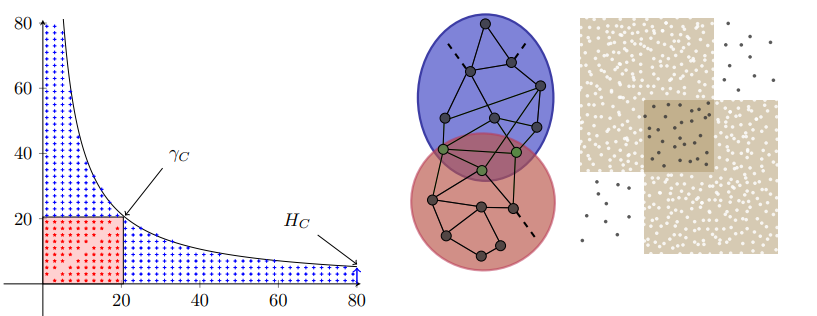

## $\mathrm{HyCSA}$: an algorithm to find overlapping hyperbolic communities.

|Repository structure |  Hyperbolic community |
| :--- | :---: |
|Codes directory has following sub-directories:   &bull; Results    &bull; Synthetic_Data     &bull; Real_World_Data.   `Real_World_Data`  and `Synthetic_Data` contain the codes for obtaining the data, while the `Results` stores the results obtained from experiments. |    *Fig. 1: A hyperbolic community and two overlapping communities.* |

## To generate synthetic networks:
Run `Codes/Synthetic_Data/Data_gen_v3_Overlaping_Comm_Sparse.py` with parameter `Save_Results=True`.

## To obtain real-world networks:
Run `Codes/Real_World_Data/Data_Gen_{Data_bsae_name}_v2.py` with parameter `Save_Results=True`.

## To run community prediction in synthetic networks:
- To run $\mathrm{HyCSA}_{\mathrm{rss}}$, we run `Codes/Main_8_Synthetic_Data_Overlap_Exp_Sparse.py` with  parameters `Initial_Seeding_Method=rss`,`Save_Results=True`.

- To run $\mathrm{HyCSA}_{\mathrm{rw}}$: 
  - we set the parameters `seeding_param=[]`. 
  - then, we run `Codes/ Main_8_Synthetic_Data_Overlap_Exp_Sparse.py` with  parameters `Initial_Seeding_Method=rw`, `Save_Results=True`.

## To run community prediction in real-world networks:

- First we set parameter `Data_base`.

- To run $\mathrm{HyCSA}_{\mathrm{rss}}$, we run `Codes/ main_8_Real_World_Idea2_mul_comm_using_Sparse.py` with  parameters `Initial_Seeding_Method=rss`,`Save_Results=True`.

