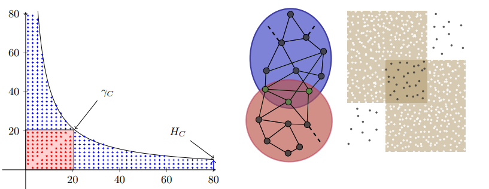

HyCSA: an algorithm to find overlapping hyperbolic communities.

|Repository structure |  Hyperbolic community |
| :--- | :---: |
| Two top-level directories:   Codes   Paper    The `Codes` folder contains the experimental code, while the `Paper` folder contains the paper and appendix. |    *Figure 1: Example of a hyperbolic community and two overlapping communities.* |

## To generate synthetic networks:
Run `Data_gen_v3_Overlaping_Comm_Sparse.py` with parameter `Save_Results=True`

## To obtain real-world networks:

## To run community prediction: